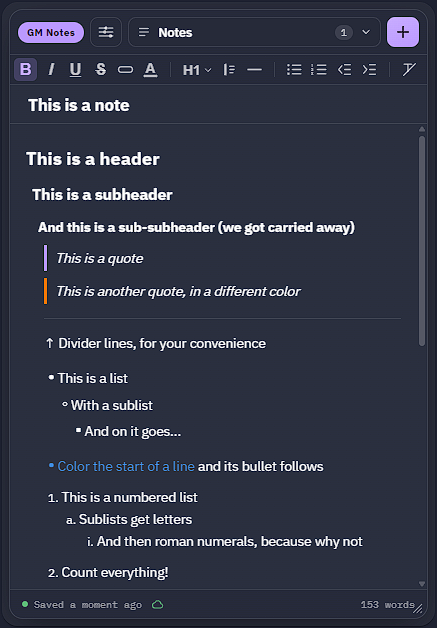
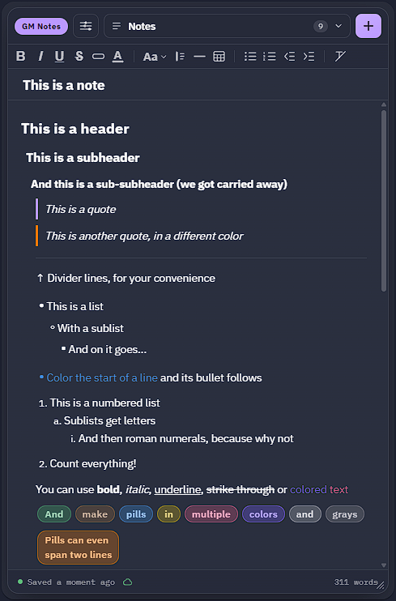
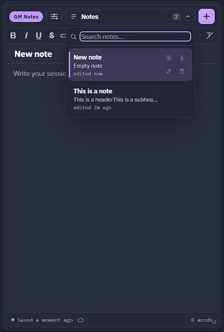
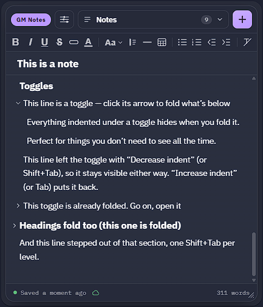
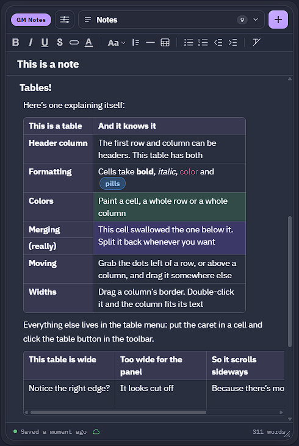
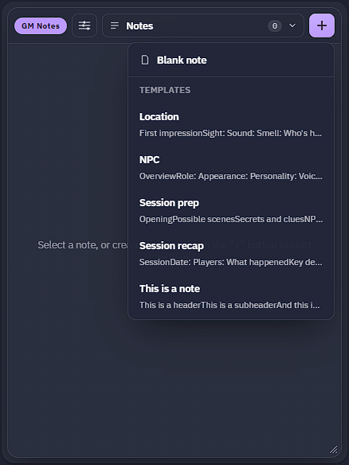
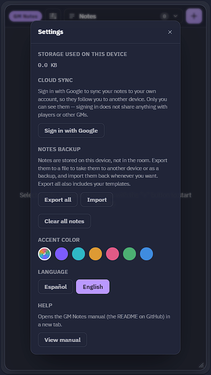

# GM Notes

An [Owlbear Rodeo](https://www.owlbear.rodeo/) extension for a private,
rich-text campaign journal for the GM, with the notes you choose shared
read-only with your players.



## Install

Add this extension to your room using its manifest URL:

```
https://notes.ijpedraza.com/manifest.json
```

## Features

- Rich text: bold, italic, underline, strikethrough, three heading levels,
  color pills, text color, colored blockquotes, dividers, and
  bulleted/numbered lists (with indent for sub-lists). Color the start of a
  list item and its bullet or number takes the same color.
- **Markdown shortcuts**: at the start of a line, type `- ` (or `* `) for a
  bullet list, `1. ` for a numbered one, `[] ` for a checklist, `# ` to
  `#### ` for headings (`#### ` is a toggle), `> ` for a quote, or `---`
  and Enter for a divider. Ctrl+Z right after keeps what you typed as text.
- **Checklists**: pick **Checklist** in the list menu and each item gets a
  box; click it to check the item off (it turns gray). Players see the
  boxes in shared notes, and can check them in the ones they can edit.
- **Tables**: header rows and columns, cell colors, merged cells, columns
  you can resize, and rows and columns you can drag around — see
  [Tables](#tables) below.
- **Collapsible sections**: fold any heading to hide everything under it,
  and use toggles to tuck details away inside normal-looking text — see
  [Collapsible sections](#collapsible-sections) below.
- Multiple notes per room, with search and a quick switcher. **Pin** the
  notes you use most to keep them at the top, and sort the rest by most
  recent or A–Z. Each note's **⋯** menu duplicates it, moves it to a
  folder, saves it as a template, or exports it.
- **Folders**: organize your notes in folders and subfolders — see
  [Folders](#folders) below.
- **Trash**: a deleted note goes to the trash (at the bottom of the notes
  list) for 30 days, so you can restore it or delete it for good. With
  cloud sync, the trash follows you to your other devices too.
- **Share notes with players**: make any note public and players can read
  it (but not edit it), live as you write, minus any parts you've hidden
  from them. See
  [Sharing notes with players](#sharing-notes-with-players) below.
- **Links between notes and map items**: type `[[` to link to another
  note, or right-click any item on the map to link a note to it — see
  [Links between notes and map items](#links-between-notes-and-map-items)
  below.
- **Templates**: start a note from a ready-made layout instead of a blank
  page — see [Templates](#templates) below.
- **Copy and paste between notes** keeps all the formatting — pills, colors,
  headings, lists, and quotes come along as they were.
- **Paste from anywhere**: text from other apps comes in clean, without
  stray fonts or colors, and Markdown is recognized — headings,
  `**bold**`/`*italic*`, lists, `- [ ]` checklists, `> quotes`, `---` dividers, and tables all
  show up styled instead of as raw symbols.
- **Export and import**: save a note (or all of them at once) as a file, and
  bring it back whenever you want. Choose JSON to keep everything exactly
  as it was, or Markdown for a plain-text copy you can read or edit
  anywhere else. Exporting everything keeps your folders, and importing
  it puts each note back in its folder.
- Personal accent color and language (English/Spanish) per player.
- Resizable panel: drag the corner handle, or double-click it to return to
  the default size.





## Folders

Group your notes the way you think about your campaign — NPCs, places,
sessions, one folder per arc — in folders up to three levels deep.

- **New folder** sits at the bottom of the notes list. A folder's **⋯**
  menu adds a note or a subfolder inside it, renames it, moves it, or
  deletes it.
- Click a folder to fold or unfold it. Each one shows how many notes it
  holds, its subfolders' included.
- **Move** a note or a folder with **Move to…** in its **⋯** menu, or drag
  it: onto a folder to put it inside, onto a note to put it next to it, or
  to the bottom of the list to take it out of every folder. A line shows
  exactly where it will land.
- Moving a note doesn't count as editing it: it keeps its place in the
  "most recent" order.
- **Searching** shows only the folders with a match, open. Search for a
  folder's name to see everything in it.
- **Deleting a folder** asks first, telling you how many notes and
  subfolders it holds. Its notes go to the trash, where you can restore
  them for 30 days.
- Players don't see your folders: they get a simple list of the notes you
  share.

## Collapsible sections

Long notes stay easy to scan: click the arrow next to any heading (or put
the cursor in it and press **Ctrl+Enter**) to fold everything under it, up
to the next heading of the same or a higher level. Fold a whole chapter to
see just its outline, then open only the part you need at the table.

- Pick the block type from the toolbar's block menu: **Normal text**,
  **Heading 1–3**, or **Toggle**.
- **Toggles** look exactly like normal text, but fold the lines below them
  — handy for secret details, stat blocks, or read-aloud text you only
  want to open when it comes up.
- To continue writing outside a toggle or heading, use **Decrease indent**
  (or **Shift+Tab**) on the line: it steps out one section at a time, and
  **Increase indent** (or **Tab**) puts it back.
- Lines are indented a little for each section they're inside, so you can
  always see which heading or toggle a line belongs to.
- **Double-click empty space** to start a new line there. Below the last
  line, it starts outside every heading and toggle; between two lines, it
  joins the section it lands in.
- Folding a section doesn't count as editing the note: it won't move the
  note to the top of your list.



## Tables

Insert a table from the toolbar's table button, picking its size from a
grid. Put the cursor in a cell and the same button opens the table menu,
with everything else:

- **Headers**: make the first row, the first column, or both into headers.
- **Colors**: paint a cell, a whole row, or a whole column.
- **Merge and split** cells, to the right or down.
- **Move between cells** with the arrow keys: at the edge of a cell's text,
  they go to the cell above, below, or beside it. **Tab** goes to the next
  cell (and adds a row at the end).
- **Move rows and columns**: drag the dots to the left of a row or above a
  column, or use **Alt+Shift+arrows**.
- **Widths**: drag a column's border to resize it, or double-click the
  border and the column fits its text. The menu can also even out the
  columns, fit them all to their content, or fit the table to the panel.
- Tables wider than the panel scroll sideways, and their edge looks cut off
  so you can tell there's more.



## Links between notes and map items

- **Link to another note**: type `[[` anywhere in a note and pick one from
  the list (typing filters it; ↑/↓ and Enter, or a click). The link shows
  the note's current title, even after you rename it. Click it to open
  that note (Ctrl+click opens it straight away). A link to a deleted note
  turns gray.
- **Players** can follow links to notes that are shared with them; a link
  to a private note reaches them as plain text, so it never points at
  something they can't see.
- **Link a note to a map item**: right-click any item on the map (a token,
  a door, a marker…) and choose **Link note**, then pick the note. From
  then on, **Open note** in that same menu opens it. Select several items
  to link them all to the same note.
- **Players open shared notes from the map**: when an item's note is
  visible or public, players get **Open note** on that item too. Items with
  private notes show them nothing.
- **Icon on the map**: once a note has linked items, a round speech-bubble
  button shows in its title row; turn it on to put a small icon on them. **Double-click** the icon for a quick
  view of the note right there on the map, with **Open in the panel** to go
  on from it. Turn it on only for notes worth a glance (an NPC's tactics, a
  door's trap), so the map stays clean. Players see the icon only on items
  whose note is shared with them, and never on hidden items.
- **A note's connections**: the small button at the end of its title shows
  how many map items and notes link to it. Click it to see them: click an
  item to select it on the map (× unlinks it), or a note to open it. A
  note deleted for good is unlinked from its items. **Settings → Linked items** takes the menu entry out
  (the links are kept). Only the GM sees the connections.


## Templates

The **+** button lets you start a blank note or begin from a template, so
recurring notes — an NPC, a location, the plan for next session — always
start with the right sections in place.

- **Templates come ready to use**: NPC, Location, Session prep, Session
  recap, and empty stat blocks for a D&D 5e monster and a Daggerheart
  adversary or environment — plus **This is a note**, a quick tour of every formatting
  option that you can delete once you've had a look. They follow your
  chosen language, and a note you create from one keeps that language from
  then on.
- **Make your own**: set up any note the way you like, then save it as a
  template with the template button on its row in the notes list.
- **Rename or delete** templates right from the **+** menu. Deleted one of
  the built-in templates? **Restore default templates**, at the bottom of
  the same menu, brings it back.
- Templates are available in **every room**, not just the one you made
  them in. They're included when you export all your notes, and they sync
  across devices along with your notes when you're signed in.



## Sharing notes with players

Any note can be shared with your players, either for them to read or for
them to edit too. Sharing needs you to be signed in (Settings → Cloud
sync), since shared notes are stored in the cloud for players to reach.

- **Share a note**: open it and click the **GM Notes** pill at the top
  left. It opens a menu with three choices:
  - **Private**: only you see it (every note starts this way).
  - **Visible**: players read it. The pill turns green and reads
    **Visible**, and the note gets a green dot in the notes list.
  - **Public**: players read it and edit it too. The pill turns orange
    and reads **Public**, and the dot is orange.

  Sharing a note asks first; sharing it less (back to visible or private)
  doesn't.
- **What players see**: when a player opens GM Notes, they get the shared
  notes, and nothing else. They can pick and search them and fold their
  sections. Visible notes are read-only: no toolbar. There's no **+**
  button either way, so players can't make notes of their own. In
  Settings they only get the language, the accent color, and the manual.
- **Your edits reach them live**, within about 15 seconds for a visible
  note, and right away for a public one.
- **Hide parts of a note**: hover a line and click the eye that shows up
  in the margin, or select one or more lines and click the eye button
  (the last one in the toolbar). Each line hides on its own (a paragraph,
  a heading, a list item), and players never see it: it's taken out
  before the note is shared. Hidden lines show in a darker box (lines
  hidden in a row share one), each with its eye: click it to show that
  line again (Ctrl+Z undoes it). If you'd rather the eyes beside the text
  ignore clicks, lock them in Settings → Hidden parts. Hiding something in a public
  note takes it away from players right away, but text you write first
  and hide afterwards was visible until then, so hide the line first
  and then write in it. A new line started from a hidden one is hidden
  too. When you share a note, the confirmation says how many hidden
  parts it has.
- **Hidden parts in Markdown** go between `<!-- hidden -->` and
  `<!-- /hidden -->` lines, which Markdown viewers don't show; a hidden list
  item ends in `<!-- hidden -->` instead. Exporting writes them, and
  importing or pasting reads them back (`<!-- oculto -->` works too).
- **Stop sharing**: pick **Private** from the pill's menu. Deleting a
  shared note also takes it away from players.
- **Regenerate key** (Settings → Shared notes): players read the public
  notes through a key stored in the room. If someone no longer in the
  room might still have it, regenerate it. From then on they stop seeing
  anything, and everyone in the room carries on without noticing.
- **Signing out** with shared notes asks first whether to unpublish them.
  Signed out, they can't be updated or unpublished, so players would keep
  seeing them as they are until you sign in again.


### Notes players can edit

A **public** note is everyone's to edit: a party inventory, a shared
journal, the list of NPCs they've met.

- **One person at a time.** Whoever starts typing has the note; for
  everyone else (you included) it turns read-only, and the bar at the
  bottom says who's editing it. Whoever has it gets a **Done** button
  there instead: clicking it frees the note right away. It's also free
  again as soon as they move to another note or stop typing for a minute
  (or, if they lose their connection, after 45 seconds).
- **Players edit the text and the title**, with the same toolbar as you,
  except for hiding lines. They can't delete the note, change who sees
  it, or link it to map items. The `[[` list only offers them the notes
  shared with them; links to your private notes read as plain text to
  them.
- **No hidden parts.** Making a note public shows its hidden lines (the
  confirmation says how many it has), and there's no eye to hide anything
  while it stays public. Back to visible, you can hide lines again.
- **Their changes reach your note**, and its ⋯ menu gets **Undo the
  players' changes**: it brings back your version from before them (from
  before the first change since your own last edit). Editing the note
  yourself keeps their changes as part of it.
- **You need to be signed in** to edit a public note, so your changes
  reach the players.


## Notes live on your device — with optional cloud sync

Each note is saved on the device you wrote it on. To bring a note
somewhere else, or just keep a backup, export it (or all your notes at
once, from Settings) and import the file wherever you need it.

Want your notes, folders, and templates on more than one device
automatically? Sign in with Google from Settings and they'll sync in the background — no setup
beyond that one sign-in. It's entirely optional and only you can see
your own notes; signing in doesn't share anything with players or other
GMs. Only the notes you make public are shared, and only with the
players in your room.

Need this manual again? Settings → Help → View manual opens it in a new
tab.



## Support

Found a bug or have a feature request? Open an issue at
<https://github.com/nachoijp/owlbear-gm-notes/issues>.
