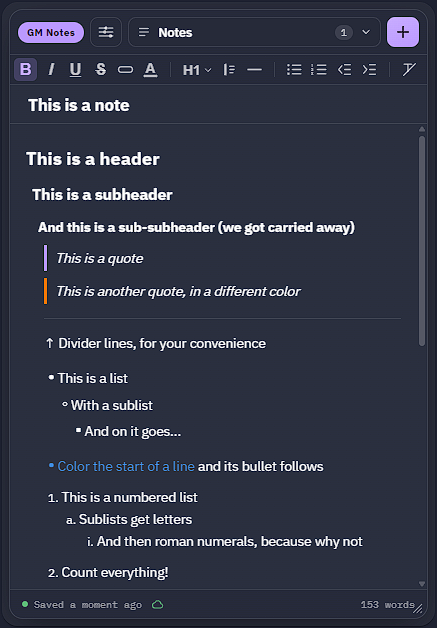
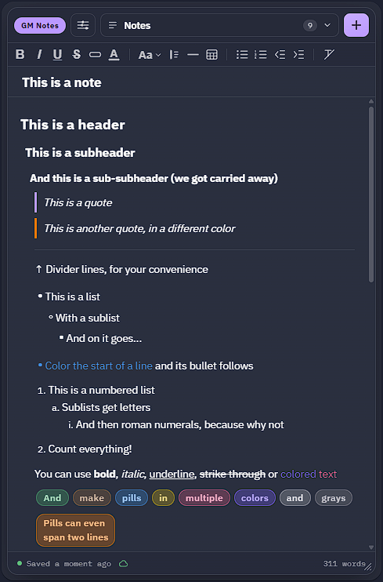
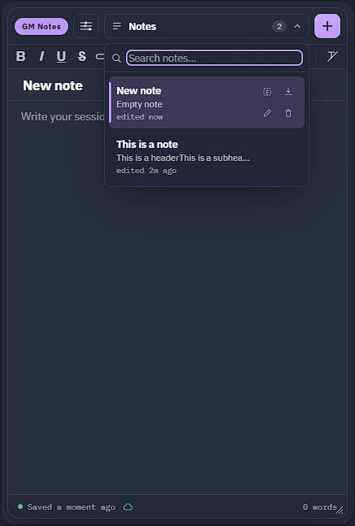
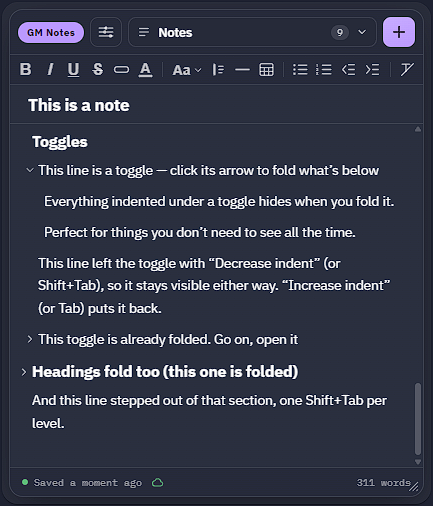
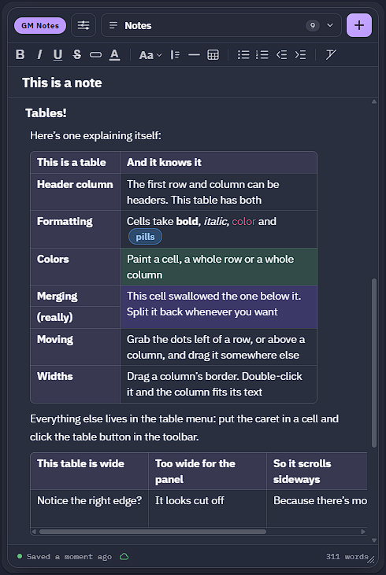
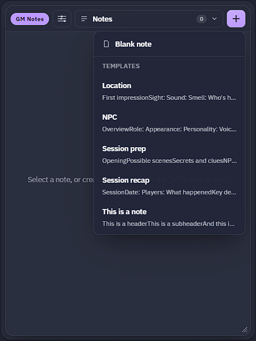
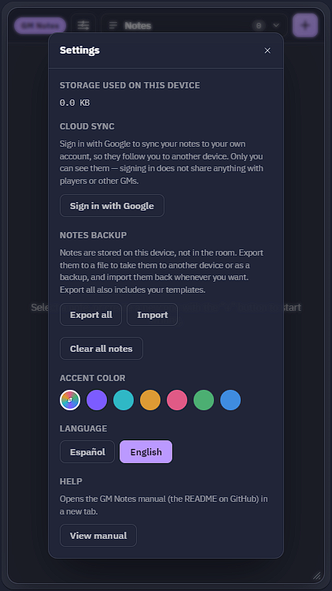

# GM Notes

A rich-text note-taking panel for the GM. Your notes stay private unless
you choose to share one: players who open GM Notes see only the notes
you shared, to read or, if you let them, to edit.

## How to use

1. Click the GM Notes icon in the toolbar.
2. Create a note with the **+** button — blank, or from a template — and
   write using the toolbar or by pasting text. Markdown syntax (headings,
   bold/italic, lists, quotes, dividers, tables) is recognized automatically and
   converted to real formatting, and copying between notes keeps all your
   formatting.
3. Switch between notes, search them, and organize them in folders from
   the dropdown at the top.

## Folders

Group your notes in folders and subfolders — NPCs, places, sessions, one
per arc. Add notes and subfolders from a folder's **⋯** menu, and move
things with **Move to…** or by dragging them: a line shows exactly where
they'll land. Searching shows only the folders with a match, and deleting
a folder sends its notes to the trash, so nothing is lost by accident.

## Collapsible sections

Fold any heading to hide everything under it, so long notes stay easy to
scan and you open only the part you need at the table. **Toggles** look
like normal text but fold the lines below them — perfect for secrets,
stat blocks, or read-aloud text. A small indent shows which section each
line belongs to, and **Decrease indent** (or **Shift+Tab**) steps a line out
of a section to keep writing outside it. Double-click the empty space
below your note to start a fresh line outside every section.

## Tables

Insert a table from the toolbar and build it up from the table menu: header
rows and columns, cell colors, merged cells, and rows and columns you can
drag into place. Drag a column's border to resize it, or double-click it to
fit the column to its text. The arrow keys move from cell to cell, and
tables wider than the panel scroll sideways.

## Links between notes and map items

Type `[[` in a note to link to another one; click the link to open it.
Right-click any item on the map (a token, a door, a marker…) and choose
**Link note** to tie a note to it, then **Open note** from that same menu
whenever you need it. The button at the end of a note's title lists its
linked items and the notes that link to it. Players only ever see links to
notes you've shared.

## Templates

Start recurring notes with the right sections already in place. GM Notes
comes with ready-made templates — NPC, Location, Session prep, Session
recap, empty stat blocks for a D&D 5e monster and a Daggerheart adversary
or environment, and a quick tour of every formatting option — in your
chosen language, and you can save any note of your own as a template from the notes list. Templates are available in every room,
and can be renamed or deleted from the **+** menu.

## Sharing notes with players

Signed in, open a note and click the **GM Notes** pill to share it:
**Visible** (green) for players to read it, or **Public** (orange) for
them to edit it too, one person at a time: everyone else sees who's
editing, and **Done** frees the note. Your changes reach them live, theirs reach you, and **Undo the
players' changes** in the note's ⋯ menu brings your version back. Pick
**Private** to stop sharing. Parts you hide with the eye button never
reach players: each line hides on its own, from a whole paragraph to a
single list item (a public note has no hidden parts). If someone no
longer in the room might still have access, **Regenerate key** in
Settings cuts them off.

## Notes live on your device — with optional cloud sync

Each note stays on the device you wrote it on. To bring a note somewhere
else, or just keep a backup, export it — one note or all of them at once —
as JSON (keeps everything exactly as it was) or Markdown (a plain-text
copy you can read or edit anywhere), and import the file back whenever
you want. Exporting all your notes includes your templates and keeps your
folders.

Want your notes, folders, and templates on more than one device automatically?
Sign in with Google from Settings — that's the only setup needed. It's entirely
optional, and only you can see your own notes, except the ones you
share.

## Support

If you run into a bug or have a feature request, please open an issue at
<https://github.com/nachoijp/owlbear-gm-notes/issues>.
